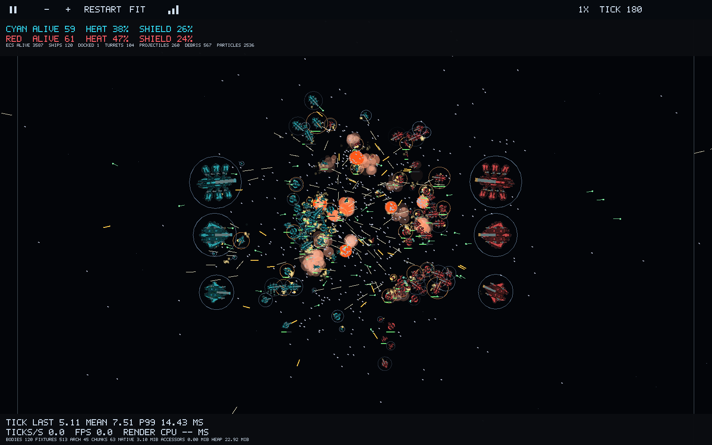

[English](README.md) | Русский

**[Промо Space Battle: четыре записанных ролика](docs/promo/space-battle/README.ru.md)**

<p align="center">
  
</p>

# SECS — ShortKedr ECS

Небольшая архетипная ECS для .NET 8. SECS хранит unmanaged-компоненты в чанках,
обновляет их типизированными запросами через `ref` и последовательно выполняет
системы в `PreUpdate`, `Update` и `PostUpdate`. В репозитории есть тесты,
бенчмарки и автономный пример Space Battle.

## С чего начать

| Ваша задача | Куда перейти |
| --- | --- |
| Использовать библиотеку | [Быстрый старт](#быстрый-старт) · [API и правила времени жизни](docs/secs/README.ru.md) · [Исходник примера](SECS.Sample/Program.cs) |
| Развивать SECS | [Реализованные оптимизации](docs/SECS_OPTIMIZATION.ru.md) · [Планы развития](docs/README.ru.md#развитие-библиотеки) |
| Прочитать или воспроизвести измерения | [Микробенчмарки](SECS.Benchmarks/README.ru.md) · [Сравнение пяти фреймворков](Benchmarks.Local/README.ru.md) · [Отчёт Space Battle](docs/space-battle/REPORT.ru.md) |
| Запустить игру | [Desktop](SpaceBattle.Game/README.ru.md) · [Headless](docs/space-battle/REPORT.ru.md) · [Web](SpaceBattle.Web/README.ru.md) |

## Быстрый старт

Нужен .NET SDK с поддержкой .NET 8. Запускайте из корня репозитория. Эти
настройки PowerShell сохраняют кеши инструментов и пакетов внутри проекта:

```powershell
$env:DOTNET_CLI_HOME = "$PWD/Benchmarks.Local/.dotnet"
$env:NUGET_PACKAGES = "$PWD/Benchmarks.Local/nuget-packages"

dotnet run --project SECS.Sample/SECS.Sample.csproj -c Release
dotnet test SECS.Tests/SECS.Tests.csproj -c Release
```

Для использования SECS в своём приложении добавьте ссылку на проект
[SECS.csproj](SECS/SECS.csproj). [Руководство библиотеки](docs/secs/README.ru.md)
содержит минимальный пример запроса и объясняет владение сущностями, ссылки
на компоненты, структурные изменения и обход чанков.

## Space Battle

**[Открыть в браузере](https://shortkedr.github.io/secs/?lang=ru)** ·
**[Читать отчёт о бенчмарках](docs/space-battle/REPORT.ru.md)**

Автономные флоты используют управление через AI, стрельбу с упреждением,
турели, щиты, производство, стыковку и ремонт на авианосцах. Desktop- и
Web-клиенты работают на SECS; headless-хост также сравнивает LeoECS Lite,
LeoECS Classic, Morpeh и StaticEcs через адаптеры нативного хранения и запросов.

[](docs/space-battle/README.ru.md)

*Измеренная нагрузка, конфигурация и версии исходников указаны в отчёте.*

## Статус и подтверждения

Сейчас библиотека работает на CPU. Арифметика Fixed, time slicing,
детерминированное параллельное выполнение и GPU execution —
[планы развития](docs/README.ru.md#развитие-библиотеки). Текущие unit-тесты и
игровые checksum не доказывают равенство между платформами или CPU/GPU.
Результаты бенчмарков относятся к конкретным машинам, версиям и нагрузкам;
методика и ограничения описаны в каждом отчёте.

[Карта документации](docs/README.ru.md) ·
[Лицензии и закреплённые сторонние исходники](THIRD_PARTY_NOTICES.ru.md)
