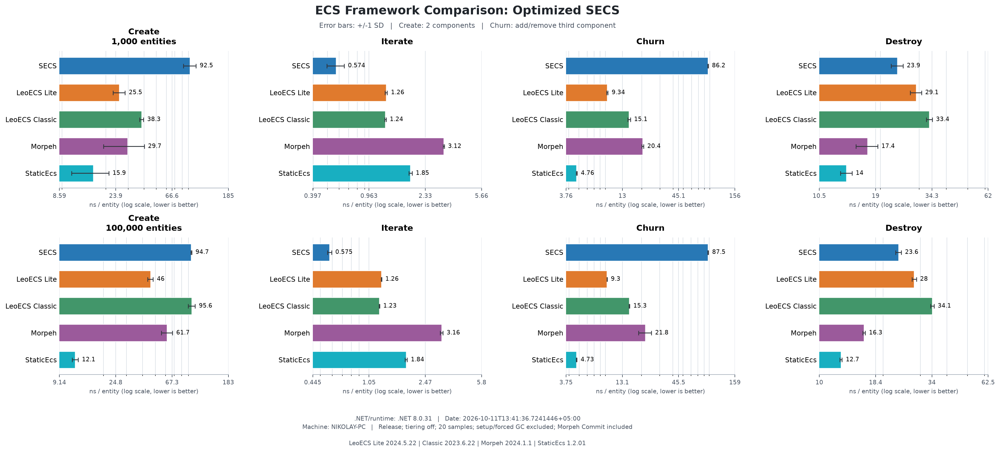
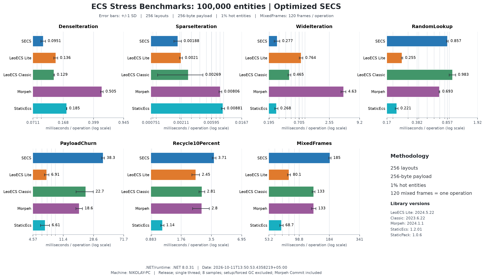
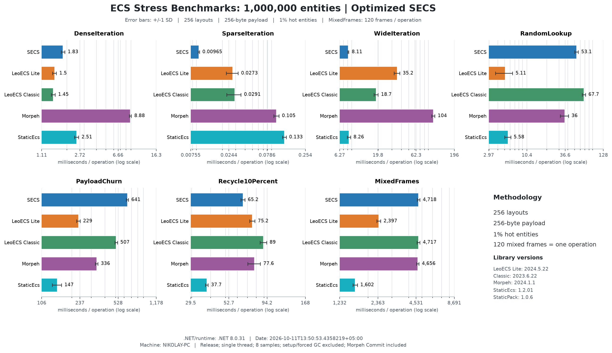
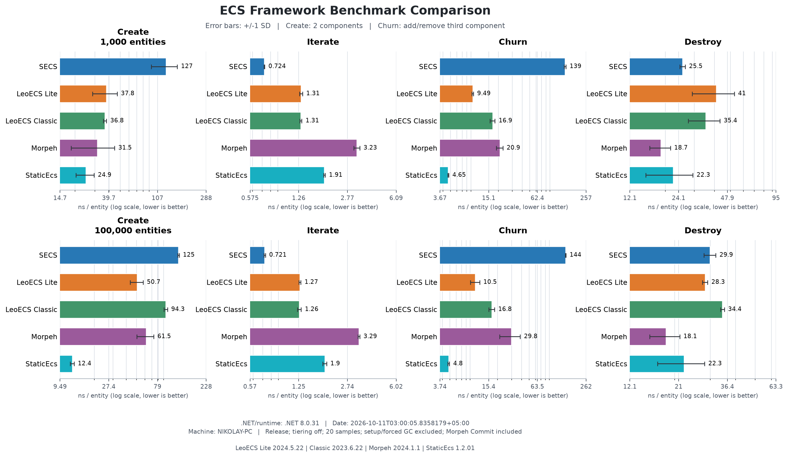
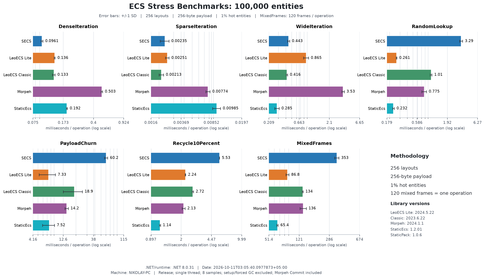
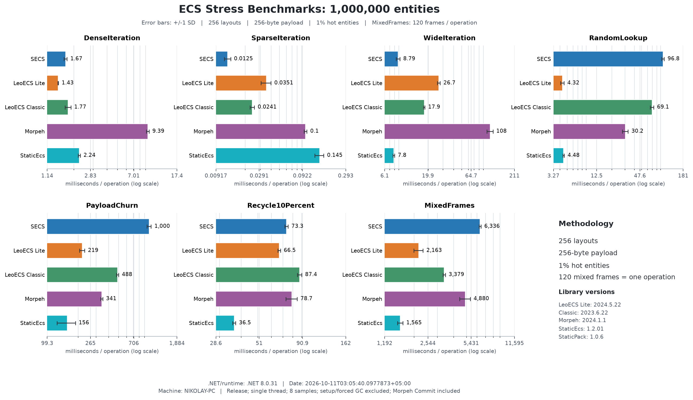
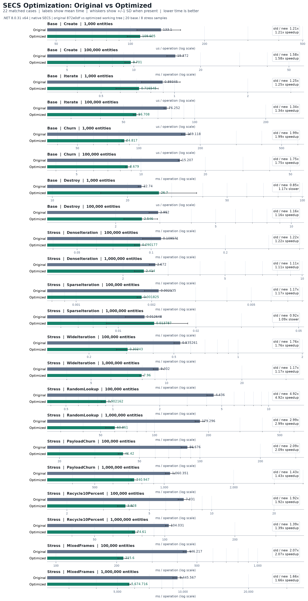

[English](README.md) | Русский

# Бенчмарки SECS

[Обзор проекта](../README.ru.md) | [Отчёт Space Battle](../docs/space-battle/REPORT.ru.md)

## Последнее полное сравнение

Обновлённый запуск заново измеряет оптимизированное рабочее дерево SECS и все
четыре других фреймворка, используя закреплённые версии, перечисленные ниже.
Он не объединяет новые замеры SECS с историческими замерами конкурентов.
Общие нагрузки используют существующие API, а не аксессоры или фабрики, доступные только в SECS.







Сырые результаты: `Benchmarks.Local/results-all-updated.json` (40 сценариев,
по 20 выборок) и `Benchmarks.Local/stress-all-updated.json` (70 сценариев, по 8 выборок).
Стресс-набор повторно запускался без построения графиков во время измерений;
первоначальный запуск сохранён как `stress-all-updated-initial.json`. Исторические
графики ниже остаются неизменными. Полосы погрешности показывают одно выборочное стандартное отклонение.

```powershell
$env:DOTNET_TieredCompilation = '0'
$env:SECS_BENCHMARK_REVISION = 'optimized working tree (872e0df + runtime optimizations)'
dotnet Benchmarks.Local/bin/Release/net8.0/Comparison.dll Benchmarks.Local/results-all-updated.json
dotnet Benchmarks.Local/bin/Release/net8.0/Comparison.dll --stress Benchmarks.Local/stress-all-updated.json
python Benchmarks.Local/plot.py Benchmarks.Local/results-all-updated.json -o docs/benchmarks/updated/comparison.png
python Benchmarks.Local/plot_stress.py Benchmarks.Local/stress-all-updated.json --output-dir docs/benchmarks/updated
```

## Набор SECS для BenchmarkDotNet

Запуск набора BenchmarkDotNet только для SECS в Release:

```powershell
dotnet run -c Release --project SECS.Benchmarks -- --filter '*ComparisonBenchmarks*'
```

`ComparisonBenchmarks` охватывает 1,000 и 100,000 сущностей. `Create` создаёт
новую партию с Position (два float) и Velocity (два float). `Iterate`
прибавляет Velocity к Position. `Churn` добавляет Mass (один float) каждой
сущности, затем удаляет его у каждой сущности. `Destroy` уничтожает заполненную партию.
Создание мира, выделение дескрипторов, заполнение для итерации, структурных изменений
и уничтожения, а также освобождение ресурсов находятся вне измеряемой операции.
Сценарии создания и уничтожения сбрасывают мир перед каждой итерацией BenchmarkDotNet.
Ёмкость чанка SECS равна 256. Запросы подготавливаются до измерения.

## Локальное сравнение



График сравнивает одинаковые логические нагрузки на SECS, LeoECS Lite,
LeoECS Classic, Morpeh и StaticEcs. Значения выражены в наносекундах на сущность; меньше лучше.
Churn включает проходы добавления и удаления, а не время одного изменения.
Отложенные структурные изменения Morpeh включают `Commit()` после каждого прохода.
Сценарий итерации использует обычный типизированный API запросов или фильтров каждой
библиотеки; это не подразумевает одинаковую компоновку памяти или реализацию запросов.

Сравнительный стенд представляет собой локальный стенд на Stopwatch, а не
вывод BenchmarkDotNet. Он проверяет данные и жизненный цикл каждой сущности
до измерения времени, прогревает каждый сценарий не менее 400 ms, измеряет
20 выборок и сообщает среднее и выборочное стандартное отклонение. Создание
и уничтожение измеряют одну новую партию на выборку с полной GC после подготовки
вне измерения; итерация и структурные изменения повторяют операцию с целевыми
30 ms на выборку (не более 1,000 повторений) и GC перед каждой выборкой.
Подготовка, освобождение ресурсов и принудительная GC исключены из замеров;
сборки мусора, вызванные самой измеряемой операцией, включены.
Полосы погрешности графика показывают одно стандартное отклонение, а не доверительные интервалы.
Release .NET 8, x64, один поток; многоуровневая компиляция отключена для сравнительного
запуска. Результаты характеризуют эту машину и эти фиксированные ревизии,
а не Unity/IL2CPP или все нагрузки. Аллокации в локальном JSON учитывают только
управляемые байты; они не включают нативное хранилище SECS и не должны
использоваться для сравнения общего потребления памяти.

Зависимости закреплены на ревизиях, указанных в существовавшей ранее
локальной копии бенчмарков:

| Фреймворк | Репозиторий | Ревизия |
| --- | --- | --- |
| LeoECS Lite | https://github.com/Leopotam/ecslite | `5053141d7d663c6b1855c8409ac93dfac807b239` |
| LeoECS Classic | https://github.com/Leopotam/ecs | `1213c31c9ef8325d48e74a52b345c4db242d038b` |
| Morpeh | https://github.com/scellecs/morpeh | `9f6369384792a01d74df24efd35b08ae313e4f12` |
| StaticEcs 1.2.01 | https://github.com/Felid-Force-Studios/StaticEcs | `6323d710c22cfff70100fe3748de432cb5fc70c8` |
| StaticPack 1.0.6 | https://github.com/Felid-Force-Studios/StaticPack | `72ce8b993593e5cfd24c6a9289a4b132305ef493` |

`Benchmarks.Local/` содержит сравнительный стенд, адаптеры, загруженные
исходники, сырые замеры и скрипт построения графиков. Каталог намеренно не входит
в планируемый коммит и не добавлен в правила игнорирования. Приведённый выше
набор только для SECS по-прежнему можно собрать независимо от этих локальных зависимостей.

Локальное воспроизведение из корня репозитория (требуется доступный matplotlib):

```powershell
./Benchmarks.Local/fetch.ps1
dotnet build Benchmarks.Local/Comparison.csproj -c Release -p:GeneratePackageOnBuild=false
$env:DOTNET_TieredCompilation = '0'
dotnet Benchmarks.Local/bin/Release/net8.0/Comparison.dll Benchmarks.Local/results.json
python Benchmarks.Local/plot.py
```

Пути планируемого коммита: изменения только бенчмарков в `SECS.Benchmarks/`,
`SECS.OtherBenchmarks/` и PNG-графики в `docs/benchmarks/`. Исходники среды выполнения,
локальные адаптеры, исходники сторонних библиотек и сырые сравнительные результаты
не входят в это изменение.

## Существующее покрытие

До добавления стресс-тестов `SECS.Benchmarks` содержал два исходных сценария
для 100,000 сущностей (итерация и структурные изменения), а также четыре
сравнительных сценария для 1,000/100,000 сущностей. `SECS.OtherBenchmarks`
содержит 48 конкретных классов: 8 создания, 14 добавления, 8 удаления компонентов,
12 структурных переходов, 1 удаления сущностей, 3 одной системы, 1 нескольких систем
и 1 несовпадения фильтров. Системы используют padding 0/10, что даёт в сумме
51 комбинацию параметров. Объявленная константа 500,000 не используется
в их атрибутах параметров. Полезные данные их компонентов представляют собой
одно целое число; сценарий нескольких систем охватывает три системы,
а несовпадение фильтров охватывает 100 несовпадающих запросов по двум компонентам.

Старый набор создания теперь содержит подготовку итерации, ограничивающую
BenchmarkDotNet одной партией создания на итерацию; это предотвращает утечку
сущностей из-за перезаписываемых дескрипторов при повторных вызовах. Удаление
сохраняет массив дескрипторов, чтобы последующие итерации подготовки продолжали
удалять запрошенную партию. Регрессионная проверка жизненного цикла:

```powershell
dotnet run -c Release --project SECS.OtherBenchmarks -- --validate
```

## Покрытие стресс-тестами

Стресс-нагрузка использует 256 базовых компоновок из восьми необязательных
четырёхбайтовых компонентов, Position/Velocity (по 12 байт) и четырёхбайтового
компонента Hot у каждой сотой сущности. Hot добавляет дополнительные варианты
состава; «256» описывает базовые маски состава, а не общее количество архетипов
SECS, создаваемых промежуточными структурными переходами. Все библиотеки получают
одинаковые маски состава, данные инициализации, случайный порядок с фиксированным
seed и операции. Velocity читается в каждом варианте движения. Hot является
обычным компонентом, а не специфичной для библиотеки оптимизацией тегов нулевого размера.

| Сценарий | Одна измеряемая операция |
| --- | --- |
| DenseIteration | Обновить все позиции во всех заполненных компоновках |
| SparseIteration | Обновить выборку 1% Hot через типизированный запрос |
| WideIteration | Обновить позиции и первые и последние поля компонента размером 256 байт |
| RandomLookup | Прочитать все позиции в перемешанном порядке с фиксированным seed и вернуть контрольную сумму |
| PayloadChurn | Добавить, затем удалить компонент размером 256 байт у всех сущностей в случайном порядке |
| Recycle10Percent | Уничтожить и пересоздать 10% в перемешанном порядке, восстановив их логические данные и компоновку |
| MixedFrames | 120 последовательных кадров: полное движение, 5% добавлений и удалений полезной нагрузки, 10% чтений, 1% пересозданий на кадр |

MixedFrames повторяет фиксированные подмножества с фиксированным seed, поэтому
измеряет устойчивые локализованные изменения, а не равномерную случайную замену
всей совокупности. Другие рандомизированные сценарии обходят полную детерминированную
перестановку. Генерация случайных чисел, сортировка, начальное заполнение сценария,
проверка, освобождение мира и принудительная GC не измеряются.
Morpeh выполняет Commit обоих проходов изменения полезной нагрузки и партии
пересозданий внутри измеряемого времени. Ёмкость чанка SECS остаётся равной 256.
Диспетчеризация бэкенда выполняется один раз на партию; доступ к отдельным сущностям
использует родные типизированные API.

Запуск стресс-набора SECS в BenchmarkDotNet (14 сценариев):

```powershell
dotnet run -c Release --project SECS.Benchmarks -- --filter 'SECS.Benchmarks.StressBenchmarks.*'
```

Дополнительный профиль на 5 миллионов сущностей включается через
`$env:SECS_STRESS_EXTREME = '1'`; удалите эту переменную, чтобы вернуться
к обычному профилю 100,000/1,000,000. Он не входит в измеренное сравнение ниже.
При 5 миллионах была выполнена только быстрая проверка DenseIteration;
полный экстремальный набор не запускался.
Это масштабирование количества сущностей, а не заявление об исчерпывающей проверке всех видов сбоев.

Сравнение включает 70 сценариев (5 фреймворков x 7 нагрузок x 2 количества сущностей),
по 8 сохранённых выборок, прогрев >=300 ms и до 16 повторений с целевыми
30 ms на выборку. MixedFrames всегда выполняется один раз на выборку. Полная
GC выполняется вне таймера перед каждой выборкой. Естественная GC и аллокации,
вызванные измеряемыми операциями, остаются включёнными. Проверка контролирует
каждую сущность после подготовки и после всех вызовов, а также небольшие
граничные нагрузки (257 и 4,097 сущностей) с тремя повторениями. Она также
проверяет данные полезной нагрузки на обоих концах и выведенные из обращения
дескрипторы с учётом поколений. Данные об управляемых аллокациях не включают
нативную память и не являются измерением всей памяти.

Графики показывают миллисекунды на полную операцию, включая все 120 кадров
для MixedFrames; каждая панель имеет собственную логарифмическую шкалу.
Это не общий рейтинг архитектур. Здесь используются закреплённые версии
библиотек, а не утверждения о более поздней StaticEcs 2.x или других будущих релизах.




Локальная проверка, измерение времени и воспроизведение графиков:

```powershell
dotnet Benchmarks.Local/bin/Release/net8.0/Comparison.dll --validate-stress
$env:DOTNET_TieredCompilation = '0'
dotnet Benchmarks.Local/bin/Release/net8.0/Comparison.dll --stress Benchmarks.Local/stress-results.json
python Benchmarks.Local/plot_stress.py
```

## Проверки оптимизации среды выполнения

Графики пяти фреймворков выше сохраняют исходные замеры среды выполнения.
Оптимизированное рабочее дерево имеет отдельное парное сравнение
с сохранённым исходным бинарным файлом SECS:



См. [методологию и результаты оптимизации](../docs/benchmarks/optimization-methodology.ru.md)
и [документацию API среды выполнения](../docs/SECS_OPTIMIZATION.ru.md).
Старые тестовые сценарии остаются неизменными. Новые API прямого создания
и кешированного аксессора измеряются отдельно, а не подставляются в исходное сравнение.

```powershell
dotnet run -c Release --project SECS.Benchmarks -- --filter '*OptimizedApi*'
$env:DOTNET_TieredCompilation = '0'
dotnet Benchmarks.Local/bin/Release/net8.0/Comparison.dll --secs-only Benchmarks.Local/results-optimized.json
dotnet Benchmarks.Local/bin/Release/net8.0/Comparison.dll --stress --secs-only Benchmarks.Local/stress-results-optimized.json
dotnet Benchmarks.Local/bin/Release/net8.0/Comparison.dll --optimized-api Benchmarks.Local/optimized-api-results.json
dotnet Benchmarks.Local/bin/Release/net8.0/Comparison.dll --storage Benchmarks.Local/storage-optimized.json
python Benchmarks.Local/plot_optimization.py
```
