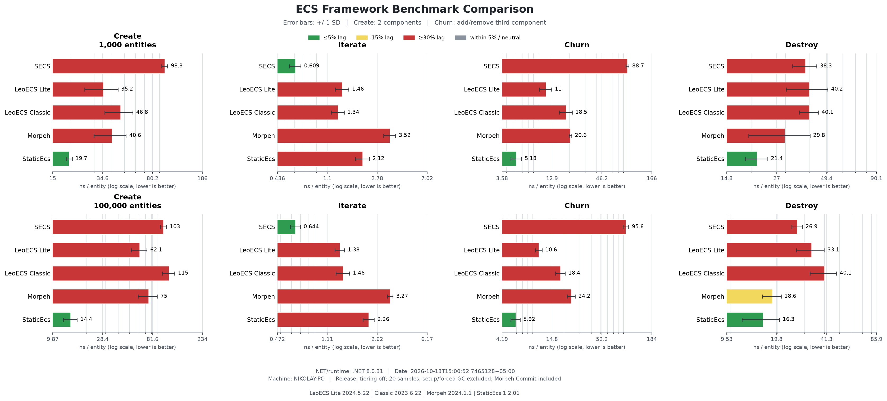

English | [Русский](README.ru.md)

# SKECS benchmarks

[Project overview](../README.md) | [SpaceBattle report](../docs/space-battle/REPORT.md) | [Harness](../Benchmarks.Local/README.md)

## Current comparison

The [current campaign report](../docs/benchmarks/current/REPORT.md) contains a fresh comparison of SKECS, LeoECS Lite, LeoECS Classic, Morpeh and StaticEcs: 40 base cases and 70 stress cases, with complete raw samples, source hashes and three charts. All five frameworks were measured again using the same shared workload contract.



The base matrix measures Create, Iterate, Churn and Destroy at 1,000 and 100,000 entities. Stress measures dense/sparse/wide iteration, random lookup, 256-byte payload churn, 10% recycling and a 120-frame mixed batch at 100,000 and 1,000,000 entities. The [report](../docs/benchmarks/current/REPORT.md) gives operation times and explains measurement limits. The [harness README](../Benchmarks.Local/README.md) documents exact scenarios and reproduction.

These are Stopwatch measurements of equivalent logical work through selected adapters. They characterize the recorded machine and snapshots; they do not establish a universal ranking or Unity/IL2CPP performance. Error bars show sample standard deviation. Managed allocations in JSON exclude native memory.

## SKECS BenchmarkDotNet suites

[ComparisonBenchmarks](ComparisonBenchmarks.cs) uses the same [base workload](ComparisonWorkload.cs) as the five-framework runner. [StressBenchmarks](StressBenchmarks.cs) uses the same [stress workload](StressWorkload.cs). [OptimizedApiBenchmarks](OptimizedApiBenchmarks.cs) evaluates separate SKECS factory/accessor APIs; these measurements are not substituted into the shared comparison. [Program.cs](Program.cs) also retains the original iteration/churn benchmarks. `SKECS.OtherBenchmarks` contains a separate legacy suite.

BenchmarkDotNet here measures SKECS only. For a quick launch check after a Release build:

```powershell
$env:DOTNET_CLI_HOME = "$PWD/Benchmarks.Local/.dotnet"
$env:NUGET_PACKAGES = "$PWD/Benchmarks.Local/nuget-packages"
dotnet build SKECS.Benchmarks/SKECS.Benchmarks.csproj -c Release --no-restore -p:GeneratePackageOnBuild=false -m:1
dotnet SKECS.Benchmarks/bin/Release/net8.0/SKECS.Benchmarks.dll --filter '*ComparisonBenchmarks.Iterate*' --job Dry --inProcess --artifacts Benchmarks.Local/repro-bdn-smoke
```

A Dry job checks launch and workload execution. The [supplemental report](../docs/benchmarks/current/SUPPLEMENT.md) contains fresh timings for all 34 default cases here and 51 legacy cases, measured with Short/InProcess, three warmup and eight actual iterations. It also includes the ten direct-creation/accessor cases and retained-native-storage diagnostics. Reproduce these sequentially, separately from the five-framework and SpaceBattle campaigns:

```powershell
./Benchmarks.Local/run_supplement.ps1
python Benchmarks.Local/report_supplement.py docs/benchmarks/current
```

The opt-in `SKECS_STRESS_EXTREME=1` matrix at five million entities is separate from the default suite. InProcess avoids generated child-project restores; its process isolation differs from the default BenchmarkDotNet toolchain.

## Historical experiments

The [2026-10-11 optimization methodology](../docs/benchmarks/optimization-methodology.md) records a separate SECS before/after experiment and the preserved binaries required to interpret it. [Previous base](../Benchmarks.Local/results-all-updated.json) and [stress](../Benchmarks.Local/stress-all-updated.json) data remain available, alongside [previous charts](../docs/benchmarks/updated/comparison.png). They are retained history, not today's rating. Rebuilding the current source does not reproduce the old baseline binary.
