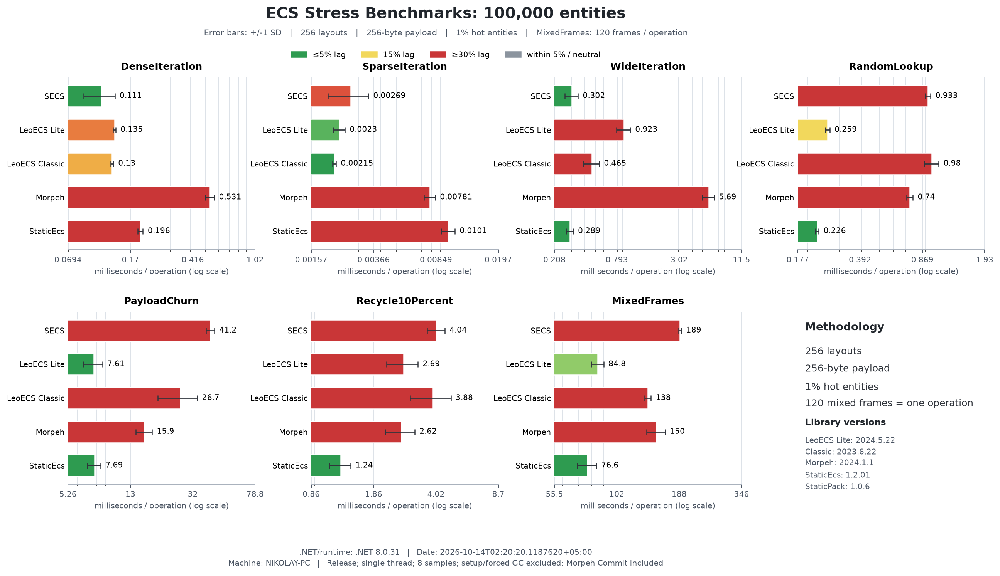
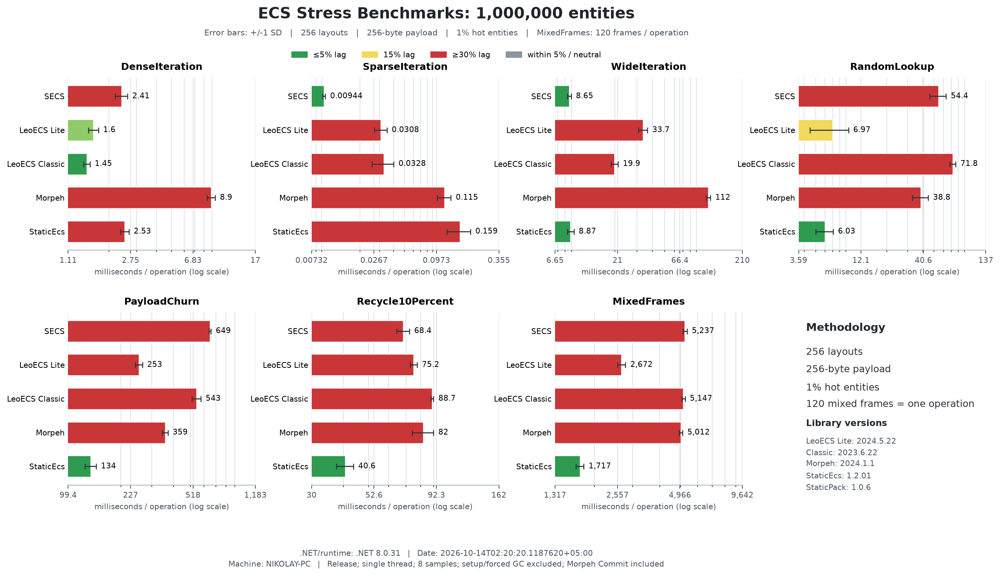

English | [Русский](REPORT.ru.md)

# ECS comparison — 2026-10-14

[Benchmark overview](../../../SECS.Benchmarks/README.md) | [Harness and reproduction](../../../Benchmarks.Local/README.md)

[Complete SECS suites and API measurements](SUPPLEMENT.md) include 34 current and 51 legacy BenchmarkDotNet cases, plus creation/accessor and retained-storage diagnostics.

All five frameworks were measured afresh in one sequential campaign: 40 base cases and 70 stress cases. Each cell below is mean milliseconds per complete operation; lower is better. Markers show relative lag within each scenario and entity-count row; they describe effect size, not statistical significance.

Environment: .NET 8.0.31, X64, AMD Ryzen 9 9900X 12-Core Processor, 24 logical processors. Release, one thread, tiered compilation off. Source revision: `80fd4f7f8d93e2a2d665d3024c615991e34199b7`. [Campaign metadata](campaign.json) pins source and measured assembly hashes; [base raw samples](base.json) and [stress raw samples](stress.json) retain all observations.

## Recorded means

| Scenario | N | SECS | LeoECS Lite | LeoECS Classic | Morpeh | StaticEcs |
| --- | ---: | ---: | ---: | ---: | ---: | ---: |
| Churn | 1,000 |  0.0861 |  0.009847 |  0.0158 |  0.0202 |  0.006209 |
| Create | 1,000 |  0.0984 |  0.0269 |  0.0413 |  0.0313 |  0.0151 |
| Destroy | 1,000 |  0.0268 |  0.0312 |  0.0389 |  0.0220 |  0.0141 |
| Iterate | 1,000 |  0.000580 |  0.001280 |  0.001247 |  0.003237 |  0.001878 |
| Churn | 100,000 |  9.369 |  0.9783 |  1.651 |  2.300 |  0.5273 |
| Create | 100,000 |  11.061 |  4.645 |  10.698 |  6.558 |  1.295 |
| Destroy | 100,000 |  2.467 |  3.159 |  3.607 |  1.710 |  1.333 |
| Iterate | 100,000 |  0.0643 |  0.1330 |  0.1303 |  0.3310 |  0.2037 |

| Scenario | N | SECS | LeoECS Lite | LeoECS Classic | Morpeh | StaticEcs |
| --- | ---: | ---: | ---: | ---: | ---: | ---: |
| DenseIteration | 100,000 |  0.1112 |  0.1350 |  0.1304 |  0.5307 |  0.1958 |
| MixedFrames | 100,000 |  189.360 |  84.752 |  138.423 |  150.057 |  76.553 |
| PayloadChurn | 100,000 |  41.224 |  7.615 |  26.706 |  15.860 |  7.695 |
| RandomLookup | 100,000 |  0.9334 |  0.2589 |  0.9805 |  0.7402 |  0.2261 |
| Recycle10Percent | 100,000 |  4.045 |  2.694 |  3.875 |  2.622 |  1.238 |
| SparseIteration | 100,000 |  0.002689 |  0.002298 |  0.002149 |  0.007807 |  0.0101 |
| WideIteration | 100,000 |  0.3019 |  0.9230 |  0.4645 |  5.688 |  0.2891 |
| DenseIteration | 1,000,000 |  2.409 |  1.601 |  1.450 |  8.901 |  2.527 |
| MixedFrames | 1,000,000 |  5237.207 |  2671.732 |  5147.027 |  5012.136 |  1716.710 |
| PayloadChurn | 1,000,000 |  648.555 |  253.369 |  543.099 |  358.604 |  134.177 |
| RandomLookup | 1,000,000 |  54.442 |  6.974 |  71.819 |  38.755 |  6.026 |
| Recycle10Percent | 1,000,000 |  68.378 |  75.179 |  88.666 |  82.024 |  40.614 |
| SparseIteration | 1,000,000 |  0.009442 |  0.0308 |  0.0328 |  0.1149 |  0.1590 |
| WideIteration | 1,000,000 |  8.646 |  33.707 |  19.938 |  111.960 |  8.866 |

### Colour scale

 up to 5% ·  15% ·  from 30% ·  neutral.

Colour shows lag from the best value in a comparable group: green → yellow → red. Groups entirely within 5% are grey. Colour describes effect size, not statistical significance. [Comparison rules](../COLORS.md).

## Charts and interpretation

Error bars show sample standard deviation, not confidence intervals. Base timings retain 20 samples; stress retains 8. Setup, validation, disposal and forced GC are excluded; natural collections and Morpeh commits during operations are included. Create/Destroy use fresh worlds; other workloads reuse warmed storage. MixedFrames is a complete 120-frame batch, not one frame. Allocation fields measure managed thread allocations and exclude native memory.

Base validation passed for all five frameworks at 1,000/100,000 entities before timing. Stress validation passed at 257/4,097 entities (all seven scenarios repeated three times, payload round-trip, retired handles); each measured stress case also passed final full-population validation. Exact matrix keys, sample counts and mean/standard-deviation consistency were checked before report generation.

These are equivalent logical operations through the selected adapters, not identical storage or each framework's best possible API. Results apply to this machine, runtime, snapshots and workload. They do not establish a universal ECS ranking, Unity/IL2CPP performance, total-memory efficiency or cross-platform determinism. The complete samples expose variability; close means should not be treated as reliable wins without further experiments.

## Retained history

Previous five-framework runs: [base](../../../Benchmarks.Local/results-all-updated.json), [stress](../../../Benchmarks.Local/stress-all-updated.json), [charts](../updated/comparison.png). The separate [SECS optimization experiment](../optimization-methodology.md) uses preserved historical binaries. Neither is the current campaign or evidence of today's before/after improvement.
