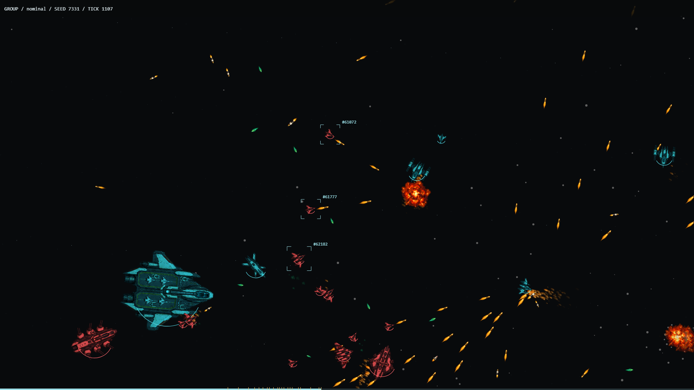
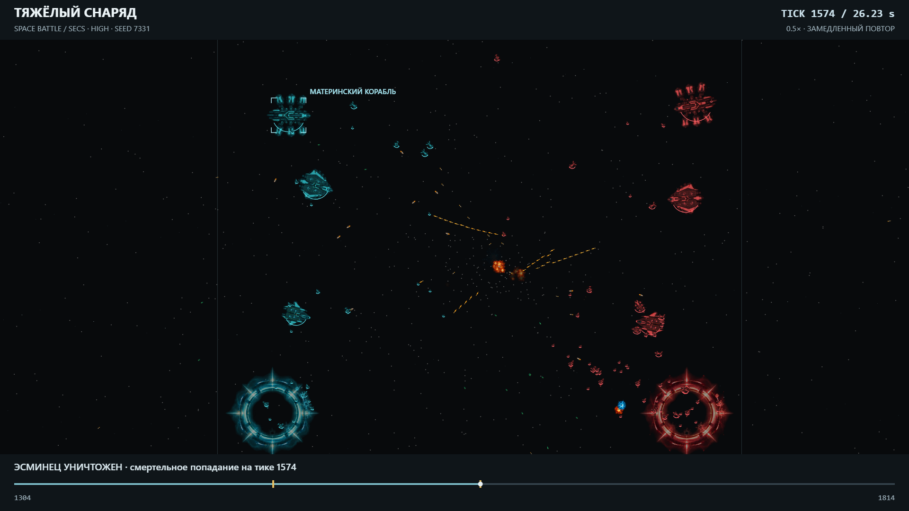
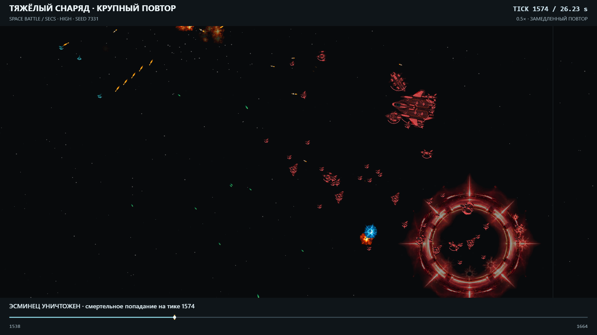
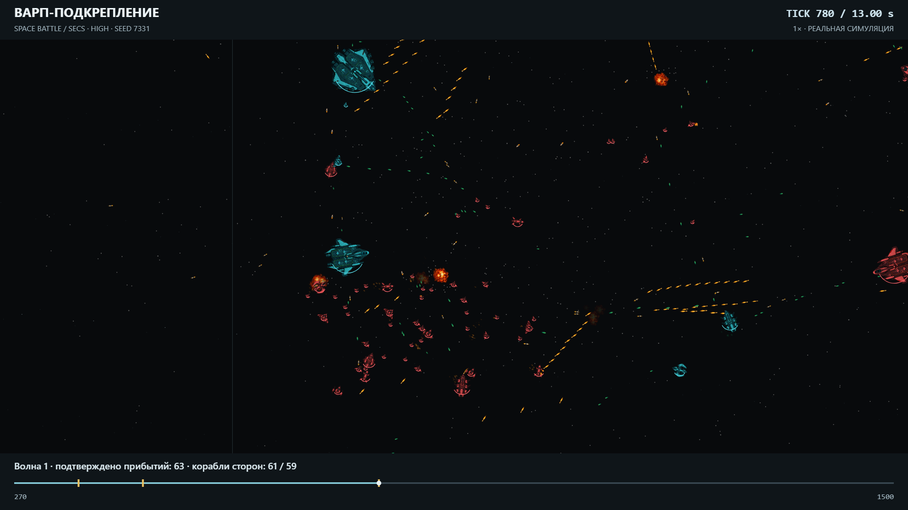

English | [Русский](README.ru.md)

# SpaceBattle in Motion

Four recorded moments from autonomous fleet combat: a squad attack, a heavy cannon strike, an impact close-up and warp reinforcements joining the battle.

## Squad Attack

A squad closes in and scores a kill at **2.58s**. This clip uses the updated smooth camera.

[Open / download MP4](01-squad-attack.mp4)

## Heavy Hit

Follow a HeavyCannon shot through flight to impact at **6.70s**. Only flight and impact are slowed to **0.5x**.

[Open / download MP4](02-heavy-hit.mp4)

## Heavy Close-Up

A closer view of the same HeavyCannon hit, landing at **1.20s**, with selective **0.5x** slow motion.

[Open / download MP4](03-heavy-closeup.mp4)

## Warp Battle

A corner portal opens at tick **360**; arrivals begin at **3.00s** (tick **450**). The battle reaches its recorded peak around **8.50s** (tick **780**), with **63 new arrivals** recorded across the clip.

[Open / download MP4](04-warp-battle.mp4)

## Recording Details

All four videos: **1920x1080**, **60 fps**, **H.264 / yuv420p**, silent **48 kHz AAC** audio track. Event times below are positions in the edited videos; selective slow motion changes their relationship to simulation ticks.

| Clip | Capture profile / seed | Simulation ticks | Duration | Frames | Highlight |
| --- | --- | --- | --- | --- | --- |
| 01 Squad attack | nominal / 7331 | 952..1287 | 5.60s | 336 | Kill: 1107 / 2.58s |
| 02 Heavy hit | high / 7331 | 1304..1814 | 11.33s | 680 | HeavyCannon hit: 1574 / 6.70s; selective 0.5x |
| 03 Heavy close-up | high / 7331 | 1538..1664 | 3.33s | 200 | HeavyCannon hit: 1574 / 1.20s; selective 0.5x |
| 04 Warp battle | high / 7331 | 270..1500 | 20.52s | 1231 | Portal: 360; arrival: 450 / 3.00s; peak: 780 / ~8.50s; 63 new arrivals |

The squad attack uses the latest smooth-camera capture. The other three clips come from earlier capture builds. These recordings illustrate combat, not current benchmarks, balance validation or proof of cross-platform equivalence.

[Recording provenance](provenance.json) | [Scene search and capture](../../../tools/space-battle/scenes/README.md) | [Repository README](../../../README.md)
