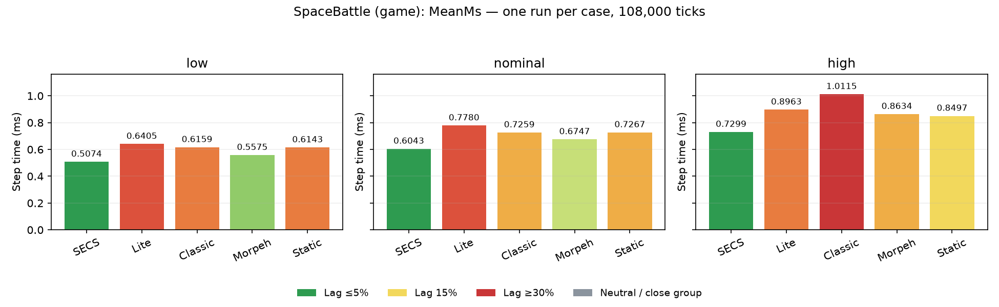
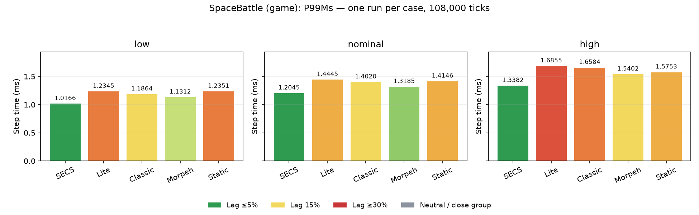

[English](GAME_REPORT.md) | Русский

# Бенчмарки Space Battle — игровой preset

Preset: `game`.

Актуальная кампания: 2026-10-14T02:22:33.7215119+05:00 — 2026-10-14T02:41:10.5729133+05:00.

Текущая headless-симуляция измерена на пяти ECS: SECS, LeoEcsLite, LeoEcsClassic, Morpeh и StaticEcs. Ревизии игровых систем: `mounted-armament-v7`, `layered-squads-v3`, `circle-kernel-v1`, `layered-weapon-damage-v1`.

**Проверка пройдена:** 15 случаев, 1 620 000 измеренных тиков. В каждом профиле совпали все 30 контрольных точек, итоговые checksum, игровые и тактические счётчики и поминутная численность сущностей.

Тики CSV проверены локально: пересчитаны среднее, квантили, разброс, превышения бюджета и аллокации. Хеши исходных CSV сохранены в манифесте.

## Как читать результаты

Каждый случай — один независимый прогон из 108 000 тиков (30 минут симуляции) после отдельного прогрева на 600 тиков. Low/nominal/high меняют только churn: 0.5/1/2. Seed 7331, 96 эскортов и 3 носителя на команду, 60 тиков/с.

Preset game: LightSwarm, Tactical, EndlessReinforcements=true, ReplenishCarriers=false — параметры симуляции desktop Release по умолчанию.

Время Step включает игровые системы, физику и структурные commit. Рендеринг, начальное заполнение, snapshots и запись телеметрии не входят. Бюджет 16.67 ms относится к симуляции, а не к FPS. Показаны наблюдения этого компьютера; один прогон на случай не даёт устойчивого рейтинга и доверительного интервала. Аллокации — управляемые выделения потока внутри Step, без нативной памяти.

Квантили headless выбирают sorted[ceil((N−1)×p)]: это верхний наблюдаемый элемент для позиции p. Live HUD использует nearest rank ceil(N×p)−1; Mean от этого различия не зависит.

Mean HUD усредняет последние до 600 тиков, тогда как общий headless Mean охватывает все 108 000 тиков после отдельного прогрева на 600 тиков. Конечный benchmark-бой может позднее обрабатывать мало живых сущностей и снижать среднее за 30 минут; игровой preset сохраняет подкрепления. Окна ниже используют внутренний Battle.LastTickMs, как HUD, и раскрывают краткие фазы и их численность. Сравнивайте результаты при одинаковых настройках боя, runtime, диапазоне тиков, прогреве и границах таймера: desktop-рендеринг и ожидание кадра в Battle.LastTickMs не входят, хотя могут влиять на нагрузку процесса.

### Цветовая шкала

 до 5% ·  15% ·  от 30% ·  нейтрально.

Цвет показывает отставание от лучшего значения в сопоставимой группе: зелёный → жёлтый → красный. Если вся группа укладывается в 5%, она серая. Цвет описывает размер различия, а не статистическую значимость. [Правила сравнения](../benchmarks/COLORS.ru.md).

Другой режим: [конечный бой](REPORT.ru.md).

[Профиль Release-клиента и первые тики HUD](DESKTOP_TIMING.ru.md) отдельно проверяют холодный старт, tiering и paced replay.

## Время тика

| Profile | ECS | Mean ms | P95 ms | P99 ms | Max ms | >16.67 ms | Managed B/tick | Total Step s |
| --- | --- | ---: | ---: | ---: | ---: | ---: | ---: | ---: |
| low | secs |  0.4672 |  0.7500 |  1.0166 |  3.7413 |  0 |  334.0 |  50.458253 |
| low | lite |  0.5979 |  0.9252 |  1.2345 |  4.1575 |  0 |  353.3 |  64.576727 |
| low | classic |  0.5632 |  0.8822 |  1.1864 |  4.1512 |  0 |  356.3 |  60.823189 |
| low | morpeh |  0.5280 |  0.8417 |  1.1312 |  5.1702 |  0 |  347.0 |  57.019892 |
| low | static |  0.5826 |  0.9200 |  1.2351 |  4.5362 |  0 |  334.6 |  62.916557 |
| nominal | secs |  0.5832 |  0.9282 |  1.2045 |  3.7894 |  0 |  452.4 |  62.986008 |
| nominal | lite |  0.7431 |  1.1242 |  1.4445 |  4.1424 |  0 |  490.5 |  80.252474 |
| nominal | classic |  0.7069 |  1.0887 |  1.4020 |  3.8169 |  0 |  488.5 |  76.341042 |
| nominal | morpeh |  0.6582 |  1.0214 |  1.3185 |  3.8431 |  0 |  501.3 |  71.081439 |
| nominal | static |  0.7315 |  1.1126 |  1.4146 |  4.4241 |  0 |  460.3 |  78.999597 |
| high | secs |  0.6706 |  1.0545 |  1.3382 |  3.7647 |  0 |  601.6 |  72.424150 |
| high | lite |  0.8938 |  1.3610 |  1.6855 |  3.9208 |  0 |  681.0 |  96.532782 |
| high | classic |  0.8236 |  1.2871 |  1.6584 |  4.3710 |  0 |  667.5 |  88.950640 |
| high | morpeh |  0.7654 |  1.2016 |  1.5402 |  4.6636 |  0 |  655.8 |  82.667862 |
| high | static |  0.8001 |  1.2455 |  1.5753 |  4.1015 |  0 |  613.7 |  86.408578 |





## Состояние симуляции и стадии

| Profile | Checksum | Ships | Turrets | Shots | Hits | Created | Destroyed |
| --- | --- | ---: | ---: | ---: | ---: | ---: | ---: |
| low | 2AE0137EB76FD5B7 | 72 | 54 | 520565 | 433351 | 11770 | 11698 |
| nominal | 627DB57B4EA32EDE | 91 | 46 | 688880 | 537592 | 15487 | 15396 |
| high | 7EE0B6054181F4AE | 89 | 48 | 945589 | 728514 | 17469 | 17380 |

Среднее всех 108 000 тиков, ms. Каждая строка сравнивает одинаковую стадию и профиль пяти ECS. Total Step — отдельный внешний таймер всей симуляции, включая commit и накладные расходы между стадиями; это не сумма строк. Total Step s = Mean ms × 108 000 / 1000; это измеренное время Step, а не WallSeconds процесса.

### low

| Stage | SECS | Lite | Classic | Morpeh | StaticEcs |
| --- | ---: | ---: | ---: | ---: | ---: |
| collect |  0.0938 |  0.1154 |  0.1015 |  0.1006 |  0.1091 |
| ai |  0.0972 |  0.1157 |  0.1112 |  0.1031 |  0.1155 |
| thermal-inventory |  0.0099 |  0.0161 |  0.0144 |  0.0124 |  0.0163 |
| steering |  0.0300 |  0.0368 |  0.0349 |  0.0327 |  0.0399 |
| weapons |  0.0220 |  0.0288 |  0.0249 |  0.0241 |  0.0293 |
| carriers |  0.0005 |  0.0005 |  0.0004 |  0.0004 |  0.0007 |
| physics |  0.0639 |  0.1048 |  0.0898 |  0.0942 |  0.1013 |
| hits |  0.1271 |  0.1494 |  0.1555 |  0.1346 |  0.1444 |
| lifecycle |  0.0227 |  0.0302 |  0.0305 |  0.0258 |  0.0261 |
| Total Step |  0.4672 |  0.5979 |  0.5632 |  0.5280 |  0.5826 |

### nominal

| Stage | SECS | Lite | Classic | Morpeh | StaticEcs |
| --- | ---: | ---: | ---: | ---: | ---: |
| collect |  0.1416 |  0.1696 |  0.1490 |  0.1472 |  0.1577 |
| ai |  0.1054 |  0.1243 |  0.1215 |  0.1132 |  0.1221 |
| thermal-inventory |  0.0094 |  0.0147 |  0.0136 |  0.0117 |  0.0150 |
| steering |  0.0264 |  0.0322 |  0.0313 |  0.0297 |  0.0344 |
| weapons |  0.0216 |  0.0274 |  0.0243 |  0.0235 |  0.0277 |
| carriers |  0.0006 |  0.0006 |  0.0005 |  0.0005 |  0.0008 |
| physics |  0.0631 |  0.1169 |  0.0961 |  0.1032 |  0.1099 |
| hits |  0.1864 |  0.2211 |  0.2305 |  0.1973 |  0.2332 |
| lifecycle |  0.0286 |  0.0362 |  0.0399 |  0.0318 |  0.0305 |
| Total Step |  0.5832 |  0.7431 |  0.7069 |  0.6582 |  0.7315 |

### high

| Stage | SECS | Lite | Classic | Morpeh | StaticEcs |
| --- | ---: | ---: | ---: | ---: | ---: |
| collect |  0.1799 |  0.2213 |  0.1872 |  0.1844 |  0.1948 |
| ai |  0.1093 |  0.1348 |  0.1286 |  0.1179 |  0.1267 |
| thermal-inventory |  0.0094 |  0.0141 |  0.0129 |  0.0110 |  0.0144 |
| steering |  0.0247 |  0.0297 |  0.0295 |  0.0270 |  0.0313 |
| weapons |  0.0208 |  0.0271 |  0.0239 |  0.0227 |  0.0263 |
| carriers |  0.0009 |  0.0010 |  0.0008 |  0.0009 |  0.0013 |
| physics |  0.0621 |  0.1352 |  0.1038 |  0.1163 |  0.1225 |
| hits |  0.2303 |  0.2837 |  0.2871 |  0.2467 |  0.2473 |
| lifecycle |  0.0331 |  0.0468 |  0.0497 |  0.0387 |  0.0352 |
| Total Step |  0.6706 |  0.8938 |  0.8236 |  0.7654 |  0.8001 |


## Окна HUD: по 600 тиков

Первое, второе и худшее окно показывают по одной и той же фазе всех пяти ECS. Худшее — окно с максимальным средним HUD-временем среди всех ECS профиля; его границы общие, а не отдельные максимумы портов. Численность — среднее после каждого тика окна.

Среднее внутреннего HUD-таймера за все 108 000 тиков:

| Profile | HUD mean ms: SECS | Lite | Classic | Morpeh | StaticEcs |
| --- | ---: | ---: | ---: | ---: | ---: |
| low |  0.4672 |  0.5979 |  0.5631 |  0.5279 |  0.5825 |
| nominal |  0.5832 |  0.7430 |  0.7068 |  0.6581 |  0.7314 |
| high |  0.6705 |  0.8938 |  0.8236 |  0.7654 |  0.8000 |

### low

| Phase / ticks | HUD / stage mean ms | SECS | Lite | Classic | Morpeh | StaticEcs |
| --- | --- | ---: | ---: | ---: | ---: | ---: |
| first / 1–600 | HUD total |  0.5858 |  0.7348 |  0.7063 |  0.7682 |  0.7183 |
| first / 1–600 | collect |  0.0978 |  0.1209 |  0.1092 |  0.1159 |  0.1146 |
| first / 1–600 | ai |  0.1473 |  0.1724 |  0.1679 |  0.1784 |  0.1749 |
| first / 1–600 | thermal-inventory |  0.0136 |  0.0223 |  0.0218 |  0.0220 |  0.0232 |
| first / 1–600 | steering |  0.0488 |  0.0592 |  0.0574 |  0.0628 |  0.0646 |
| first / 1–600 | weapons |  0.0272 |  0.0373 |  0.0329 |  0.0363 |  0.0368 |
| first / 1–600 | carriers |  0.0002 |  0.0004 |  0.0003 |  0.0007 |  0.0007 |
| first / 1–600 | physics |  0.0998 |  0.1437 |  0.1318 |  0.1630 |  0.1401 |
| first / 1–600 | hits |  0.1232 |  0.1416 |  0.1478 |  0.1439 |  0.1346 |
| first / 1–600 | lifecycle |  0.0277 |  0.0369 |  0.0373 |  0.0452 |  0.0289 |
| second / 601–1200 | HUD total |  0.3358 |  0.4925 |  0.4735 |  0.4338 |  0.5565 |
| second / 601–1200 | collect |  0.0710 |  0.0943 |  0.0852 |  0.0811 |  0.0978 |
| second / 601–1200 | ai |  0.0608 |  0.0838 |  0.0801 |  0.0730 |  0.0984 |
| second / 601–1200 | thermal-inventory |  0.0059 |  0.0111 |  0.0103 |  0.0083 |  0.0139 |
| second / 601–1200 | steering |  0.0146 |  0.0215 |  0.0204 |  0.0180 |  0.0273 |
| second / 601–1200 | weapons |  0.0196 |  0.0287 |  0.0258 |  0.0240 |  0.0356 |
| second / 601–1200 | carriers |  0.0004 |  0.0006 |  0.0006 |  0.0007 |  0.0014 |
| second / 601–1200 | physics |  0.0305 |  0.0722 |  0.0615 |  0.0655 |  0.0814 |
| second / 601–1200 | hits |  0.1095 |  0.1473 |  0.1510 |  0.1306 |  0.1618 |
| second / 601–1200 | lifecycle |  0.0234 |  0.0330 |  0.0385 |  0.0325 |  0.0389 |
| worst / 1201–1800 | HUD total |  0.5999 |  0.9133 |  0.8238 |  0.8912 |  0.8050 |
| worst / 1201–1800 | collect |  0.1024 |  0.1388 |  0.1203 |  0.1303 |  0.1256 |
| worst / 1201–1800 | ai |  0.1445 |  0.2024 |  0.1849 |  0.2016 |  0.1844 |
| worst / 1201–1800 | thermal-inventory |  0.0135 |  0.0295 |  0.0239 |  0.0263 |  0.0258 |
| worst / 1201–1800 | steering |  0.0472 |  0.0695 |  0.0619 |  0.0693 |  0.0673 |
| worst / 1201–1800 | weapons |  0.0300 |  0.0508 |  0.0414 |  0.0451 |  0.0463 |
| worst / 1201–1800 | carriers |  0.0004 |  0.0007 |  0.0005 |  0.0009 |  0.0008 |
| worst / 1201–1800 | physics |  0.0934 |  0.1739 |  0.1469 |  0.1789 |  0.1495 |
| worst / 1201–1800 | hits |  0.1381 |  0.1963 |  0.1942 |  0.1862 |  0.1667 |
| worst / 1201–1800 | lifecycle |  0.0303 |  0.0514 |  0.0498 |  0.0526 |  0.0385 |

| Phase / ticks | Mean ships | Mean projectiles | Mean debris | Mean particles | Mean turrets |
| --- | ---: | ---: | ---: | ---: | ---: |
| first / 1–600 | 150.64 | 292.00 | 267.54 | 1110.51 | 52.00 |
| second / 601–1200 | 60.67 | 236.11 | 759.64 | 383.71 | 51.78 |
| worst / 1201–1800 | 138.62 | 353.87 | 657.10 | 781.32 | 56.97 |

Средняя численность совпадает во всех пяти ECS и показана один раз.

### nominal

| Phase / ticks | HUD / stage mean ms | SECS | Lite | Classic | Morpeh | StaticEcs |
| --- | --- | ---: | ---: | ---: | ---: | ---: |
| first / 1–600 | HUD total |  0.6789 |  0.8198 |  0.7961 |  0.7292 |  0.8269 |
| first / 1–600 | collect |  0.1437 |  0.1690 |  0.1546 |  0.1497 |  0.1467 |
| first / 1–600 | ai |  0.1473 |  0.1635 |  0.1626 |  0.1492 |  0.1718 |
| first / 1–600 | thermal-inventory |  0.0121 |  0.0183 |  0.0181 |  0.0146 |  0.0199 |
| first / 1–600 | steering |  0.0392 |  0.0470 |  0.0456 |  0.0419 |  0.0522 |
| first / 1–600 | weapons |  0.0281 |  0.0363 |  0.0314 |  0.0288 |  0.0390 |
| first / 1–600 | carriers |  0.0004 |  0.0005 |  0.0004 |  0.0004 |  0.0008 |
| first / 1–600 | physics |  0.0858 |  0.1366 |  0.1194 |  0.1221 |  0.1369 |
| first / 1–600 | hits |  0.1852 |  0.2042 |  0.2161 |  0.1840 |  0.2229 |
| first / 1–600 | lifecycle |  0.0370 |  0.0444 |  0.0479 |  0.0385 |  0.0367 |
| second / 601–1200 | HUD total |  0.7408 |  1.0588 |  0.8299 |  0.9274 |  0.9909 |
| second / 601–1200 | collect |  0.1716 |  0.2176 |  0.1731 |  0.1881 |  0.1980 |
| second / 601–1200 | ai |  0.1396 |  0.1826 |  0.1438 |  0.1651 |  0.1749 |
| second / 601–1200 | thermal-inventory |  0.0109 |  0.0208 |  0.0142 |  0.0155 |  0.0202 |
| second / 601–1200 | steering |  0.0299 |  0.0417 |  0.0315 |  0.0386 |  0.0433 |
| second / 601–1200 | weapons |  0.0264 |  0.0370 |  0.0282 |  0.0315 |  0.0373 |
| second / 601–1200 | carriers |  0.0008 |  0.0011 |  0.0006 |  0.0011 |  0.0019 |
| second / 601–1200 | physics |  0.0805 |  0.1729 |  0.1104 |  0.1552 |  0.1524 |
| second / 601–1200 | hits |  0.2336 |  0.3161 |  0.2674 |  0.2687 |  0.3055 |
| second / 601–1200 | lifecycle |  0.0475 |  0.0691 |  0.0606 |  0.0636 |  0.0573 |
| worst / 601–1200 | HUD total |  0.7408 |  1.0588 |  0.8299 |  0.9274 |  0.9909 |
| worst / 601–1200 | collect |  0.1716 |  0.2176 |  0.1731 |  0.1881 |  0.1980 |
| worst / 601–1200 | ai |  0.1396 |  0.1826 |  0.1438 |  0.1651 |  0.1749 |
| worst / 601–1200 | thermal-inventory |  0.0109 |  0.0208 |  0.0142 |  0.0155 |  0.0202 |
| worst / 601–1200 | steering |  0.0299 |  0.0417 |  0.0315 |  0.0386 |  0.0433 |
| worst / 601–1200 | weapons |  0.0264 |  0.0370 |  0.0282 |  0.0315 |  0.0373 |
| worst / 601–1200 | carriers |  0.0008 |  0.0011 |  0.0006 |  0.0011 |  0.0019 |
| worst / 601–1200 | physics |  0.0805 |  0.1729 |  0.1104 |  0.1552 |  0.1524 |
| worst / 601–1200 | hits |  0.2336 |  0.3161 |  0.2674 |  0.2687 |  0.3055 |
| worst / 601–1200 | lifecycle |  0.0475 |  0.0691 |  0.0606 |  0.0636 |  0.0573 |

| Phase / ticks | Mean ships | Mean projectiles | Mean debris | Mean particles | Mean turrets |
| --- | ---: | ---: | ---: | ---: | ---: |
| first / 1–600 | 124.69 | 461.50 | 510.83 | 1380.54 | 51.72 |
| second / 601–1200 | 87.09 | 509.46 | 1143.83 | 1075.18 | 50.52 |
| worst / 601–1200 | 87.09 | 509.46 | 1143.83 | 1075.18 | 50.52 |

Средняя численность совпадает во всех пяти ECS и показана один раз.

### high

| Phase / ticks | HUD / stage mean ms | SECS | Lite | Classic | Morpeh | StaticEcs |
| --- | --- | ---: | ---: | ---: | ---: | ---: |
| first / 1–600 | HUD total |  0.7821 |  1.0198 |  0.9825 |  0.8587 |  0.9564 |
| first / 1–600 | collect |  0.1974 |  0.2417 |  0.2129 |  0.2007 |  0.1935 |
| first / 1–600 | ai |  0.1494 |  0.1748 |  0.1738 |  0.1520 |  0.1821 |
| first / 1–600 | thermal-inventory |  0.0105 |  0.0159 |  0.0158 |  0.0125 |  0.0185 |
| first / 1–600 | steering |  0.0323 |  0.0392 |  0.0394 |  0.0336 |  0.0427 |
| first / 1–600 | weapons |  0.0273 |  0.0353 |  0.0328 |  0.0276 |  0.0382 |
| first / 1–600 | carriers |  0.0004 |  0.0005 |  0.0006 |  0.0004 |  0.0010 |
| first / 1–600 | physics |  0.0718 |  0.1531 |  0.1304 |  0.1284 |  0.1448 |
| first / 1–600 | hits |  0.2536 |  0.3043 |  0.3139 |  0.2588 |  0.2910 |
| first / 1–600 | lifecycle |  0.0395 |  0.0549 |  0.0629 |  0.0446 |  0.0445 |
| second / 601–1200 | HUD total |  1.0977 |  1.1735 |  1.3199 |  1.2386 |  1.1576 |
| second / 601–1200 | collect |  0.2653 |  0.2897 |  0.2709 |  0.2669 |  0.2579 |
| second / 601–1200 | ai |  0.1907 |  0.1870 |  0.2123 |  0.2015 |  0.1986 |
| second / 601–1200 | thermal-inventory |  0.0144 |  0.0167 |  0.0192 |  0.0184 |  0.0207 |
| second / 601–1200 | steering |  0.0371 |  0.0367 |  0.0439 |  0.0411 |  0.0436 |
| second / 601–1200 | weapons |  0.0308 |  0.0303 |  0.0349 |  0.0333 |  0.0353 |
| second / 601–1200 | carriers |  0.0014 |  0.0008 |  0.0012 |  0.0016 |  0.0017 |
| second / 601–1200 | physics |  0.1078 |  0.1751 |  0.1809 |  0.2108 |  0.1784 |
| second / 601–1200 | hits |  0.3833 |  0.3788 |  0.4622 |  0.3889 |  0.3651 |
| second / 601–1200 | lifecycle |  0.0670 |  0.0584 |  0.0944 |  0.0761 |  0.0562 |
| worst / 601–1200 | HUD total |  1.0977 |  1.1735 |  1.3199 |  1.2386 |  1.1576 |
| worst / 601–1200 | collect |  0.2653 |  0.2897 |  0.2709 |  0.2669 |  0.2579 |
| worst / 601–1200 | ai |  0.1907 |  0.1870 |  0.2123 |  0.2015 |  0.1986 |
| worst / 601–1200 | thermal-inventory |  0.0144 |  0.0167 |  0.0192 |  0.0184 |  0.0207 |
| worst / 601–1200 | steering |  0.0371 |  0.0367 |  0.0439 |  0.0411 |  0.0436 |
| worst / 601–1200 | weapons |  0.0308 |  0.0303 |  0.0349 |  0.0333 |  0.0353 |
| worst / 601–1200 | carriers |  0.0014 |  0.0008 |  0.0012 |  0.0016 |  0.0017 |
| worst / 601–1200 | physics |  0.1078 |  0.1751 |  0.1809 |  0.2108 |  0.1784 |
| worst / 601–1200 | hits |  0.3833 |  0.3788 |  0.4622 |  0.3889 |  0.3651 |
| worst / 601–1200 | lifecycle |  0.0670 |  0.0584 |  0.0944 |  0.0761 |  0.0562 |

| Phase / ticks | Mean ships | Mean projectiles | Mean debris | Mean particles | Mean turrets |
| --- | ---: | ---: | ---: | ---: | ---: |
| first / 1–600 | 104.26 | 818.02 | 859.90 | 1558.18 | 48.44 |
| second / 601–1200 | 100.58 | 970.01 | 1513.26 | 1386.75 | 44.51 |
| worst / 601–1200 | 100.58 | 970.01 | 1513.26 | 1386.75 | 44.51 |

Средняя численность совпадает во всех пяти ECS и показана один раз.


## Происхождение данных

- CPU: AMD Ryzen 9 9900X 12-Core Processor; RAM: 61.49 GiB.
- Runtime: .NET 8.0.31; OS: Microsoft Windows 10.0.26200; tiered compilation: `0`.
- Source: `bde83f13f03a5770c03fda135e3445cb0e45b192`; source SHA256: [game-current/manifest.json](game-current/manifest.json).
- [JSON](game-current/), [summary.csv](game-current/summary.csv), [hardware.json](game-current/hardware.json).

Манифест фиксирует исходники и хеши входных файлов; каждый JSON — точные upstream pins и SHA256 всех измеряемых DLL. Поле Provenance.Sources.SECS в старом headless host содержит описательную историческую строку; точная ревизия и исходники этой кампании задаются манифестом.

## Воспроизведение

Из корня проекта, с .NET 8 и доступным кешем NuGet. Для графиков нужны Python и matplotlib. Запускайте измерения последовательно, без другой нагрузочной работы. Команда перезаписывает указанный OutputDirectory; для собственных экспериментов задайте другую директорию внутри проекта.

```powershell
$env:DOTNET_CLI_HOME = "$PWD/Benchmarks.Local/.dotnet"
$env:NUGET_PACKAGES = "$PWD/Benchmarks.Local/nuget-packages"
$env:MSBuildEnableWorkloadResolver = 'false'
dotnet build SpaceBattle.Headless/SpaceBattle.Headless.csproj -c Release --no-restore -m:1 -p:GeneratePackageOnBuild=false
dotnet SpaceBattle.Headless/bin/Release/net8.0/SpaceBattle.Headless.dll --validate
dotnet SpaceBattle.Headless/bin/Release/net8.0/SpaceBattle.Headless.dll --validate-adapters
dotnet SpaceBattle.Headless/bin/Release/net8.0/SpaceBattle.Headless.dll --validate-ports
./tools/space-battle/run-suite.ps1 -SkipBuild -Preset game -OutputDirectory docs/space-battle/game-current
python tools/space-battle/analyze_current.py --data-dir docs/space-battle/game-current --preset game --report-base GAME_REPORT --verify-ticks
```

Без --verify-ticks анализатор проверяет опубликованные JSON и хеши и строит тот же отчёт без требования локальных CSV. Длинные CSV остаются локально; опубликованных JSON достаточно для сводных таблиц и графиков.

## История и связанные документы

- [Архив измерений 2026-10-11](REPORT_2026-10-11.ru.md): predictive-neutral-v1, Aether, старый frontend replay и состав сущностей. Его цифры не сравниваются с этой кампанией: изменились правила игры, физика и нагрузка.
- [Архитектура](ARCHITECTURE.ru.md), [физика](PHYSICS.ru.md), [оружие](ARMAMENT.ru.md), [тактика](TACTICS_V3.ru.md).
- [Микробенчмарки SECS](../../SECS.Benchmarks/README.ru.md): отдельная нагрузка без игровой логики.
