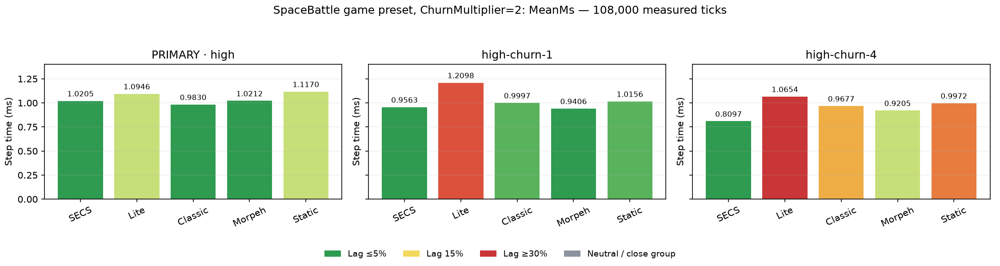
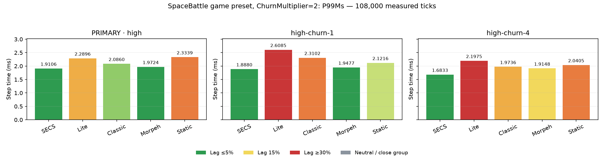
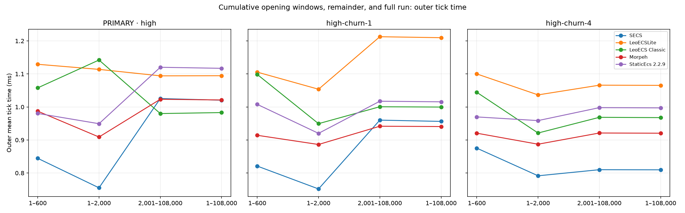
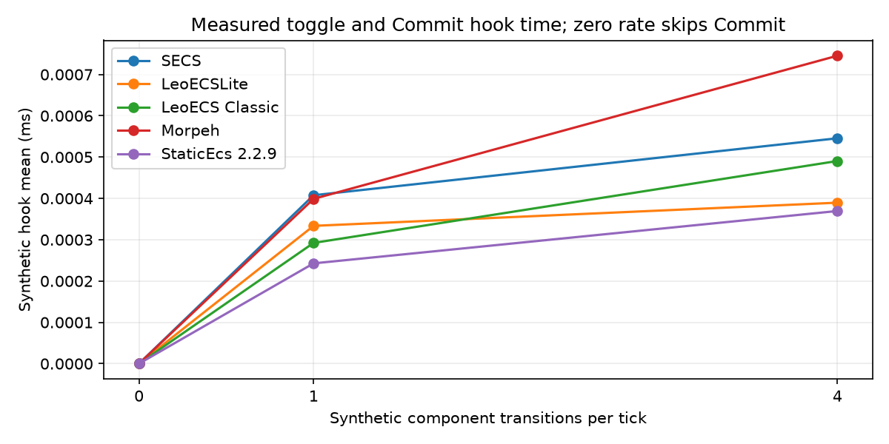

[English](REPORT.md) | Русский

# Space Battle — высокая нагрузка ECS и синтетический churn

Кампания формата 2: 2026-10-14T23:20:11.4454531+05:00 — 2026-10-14T23:47:56.0621543+05:00. Основной профиль: `high` (0 синтетических операций/тик).

Во всех профилях используется игровой preset с игровым `ChurnMultiplier=2`. `high-churn-1` и `high-churn-4` добавляют 1 и 4 инертных перехода компонента Lifetime за тик из фиксированного пула 32 сущностей. Игровое состояние не меняется. Внешний таймер тика включает этот pre-Step hook; Battle.LastTickMs и таймеры стадий его не включают. Старые результаты low/nominal/high использовали игровые значения churn 0.5/1/2 и другую матрицу; их время напрямую несопоставимо.

[Архивная кампания конечного боя](REPORT_2026-10-14_FINITE.ru.md) сохраняет прежнюю методику и результаты.

Среднее полного прогона охватывает 108 000 измеряемых тиков после отдельного прогрева боя на 600 тиков. Desktop HUD Mean охватывает последние до 600 тиков и использует Battle.LastTickMs; внешний headless-таймер дополнительно включает синтетический churn. Сравнивайте desktop и headless при одинаковых игровых настройках и диапазонах тиков.

## Проверка

Проверка пройдена: 15 случаев на пяти ECS; 1 620 000 измеренных тиков; хеши и происхождение данных совпадают; игровые checksum, счётчики, тактика и трассы сущностей совпадают между портами и тремя профилями churn. Число синтетических операций соответствует заданной частоте. Census хранилища включает фиксированный синтетический пул из 32 сущностей.

Локальные tick CSV проверены, включая синтетические операции, add/remove и время hook на каждом тике.

## Время тика

| Профиль | Синтетических операций/тик | ECS | Среднее hook, ms | Среднее внешнее время 1–600, ms | Среднее внешнее время 1–2000, ms | Среднее внешнее время 2001–108000, ms | Среднее внешнее время 1–108000, ms | P99 полного прогона, ms | Managed B/тик |
| --- | ---: | --- | ---: | ---: | ---: | ---: | ---: | ---: | ---: |
| high **основной** | 0 | SECS | 0.0000 | 0.8445 | 0.7551 | 1.0255 | 1.0205 | 1.9106 | 601.4 |
| high **основной** | 0 | LeoECSLite | 0.0000 | 1.1293 | 1.1138 | 1.0942 | 1.0946 | 2.2896 | 681.0 |
| high **основной** | 0 | LeoECS Classic | 0.0000 | 1.0578 | 1.1421 | 0.9800 | 0.9830 | 2.0860 | 667.5 |
| high **основной** | 0 | Morpeh | 0.0000 | 0.9873 | 0.9090 | 1.0233 | 1.0212 | 1.9724 | 654.2 |
| high **основной** | 0 | StaticEcs 2.2.9 | 0.0000 | 0.9804 | 0.9493 | 1.1202 | 1.1170 | 2.3339 | 621.3 |
| high-churn-1 | 1 | SECS | 0.0004 | 0.8210 | 0.7517 | 0.9601 | 0.9563 | 1.8880 | 601.5 |
| high-churn-1 | 1 | LeoECSLite | 0.0003 | 1.1055 | 1.0537 | 1.2127 | 1.2098 | 2.6085 | 682.2 |
| high-churn-1 | 1 | LeoECS Classic | 0.0003 | 1.0984 | 0.9494 | 1.0006 | 0.9997 | 2.3102 | 667.5 |
| high-churn-1 | 1 | Morpeh | 0.0004 | 0.9142 | 0.8863 | 0.9417 | 0.9406 | 1.9477 | 654.3 |
| high-churn-1 | 1 | StaticEcs 2.2.9 | 0.0002 | 1.0079 | 0.9201 | 1.0174 | 1.0156 | 2.1216 | 621.3 |
| high-churn-4 | 4 | SECS | 0.0005 | 0.8753 | 0.7915 | 0.8100 | 0.8097 | 1.6833 | 601.5 |
| high-churn-4 | 4 | LeoECSLite | 0.0004 | 1.1000 | 1.0365 | 1.0660 | 1.0654 | 2.1975 | 682.2 |
| high-churn-4 | 4 | LeoECS Classic | 0.0005 | 1.0444 | 0.9211 | 0.9686 | 0.9677 | 1.9736 | 667.5 |
| high-churn-4 | 4 | Morpeh | 0.0007 | 0.9206 | 0.8872 | 0.9211 | 0.9205 | 1.9148 | 654.3 |
| high-churn-4 | 4 | StaticEcs 2.2.9 | 0.0004 | 0.9698 | 0.9587 | 0.9979 | 0.9972 | 2.0405 | 621.3 |

В основном профиле high первые 2 000 тиков дороже остатка у 2 из пяти ECS. Среднее время самого синтетического hook составляет от 0.24 до 0.75 мкс/тик; различия полного Mean гораздо больше и меняют направление. При одном прогоне на случай эти различия нельзя приписать одному churn.

[Сводная CSV-таблица](current/summary.csv)

## Стадии основного high-профиля

| Стадия | SECS, ms | Lite, ms | Classic, ms | Morpeh, ms | StaticEcs, ms |
| --- | ---: | ---: | ---: | ---: | ---: |
| collect | 0.2224 | 0.2462 | 0.2095 | 0.2230 | 0.2373 |
| ai | 0.1748 | 0.1730 | 0.1575 | 0.1601 | 0.1825 |
| thermal-inventory | 0.0181 | 0.0198 | 0.0173 | 0.0175 | 0.0245 |
| steering | 0.0426 | 0.0400 | 0.0371 | 0.0393 | 0.0463 |
| weapons | 0.0366 | 0.0367 | 0.0311 | 0.0328 | 0.0407 |
| carriers | 0.0021 | 0.0016 | 0.0012 | 0.0014 | 0.0022 |
| physics | 0.0981 | 0.1632 | 0.1245 | 0.1578 | 0.1635 |
| hits | 0.3643 | 0.3529 | 0.3433 | 0.3355 | 0.3608 |
| lifecycle | 0.0614 | 0.0610 | 0.0614 | 0.0536 | 0.0590 |
| Battle.LastTickMs | 1.0203 | 1.0945 | 0.9829 | 1.0211 | 1.1169 |

## Совпадение игрового состояния

| Профиль | Синтетических операций/тик | Checksum | Кораблей | Турелей | Выстрелов | Попаданий | Создано | Уничтожено |
| --- | ---: | --- | ---: | ---: | ---: | ---: | ---: | ---: |
| high | 0 | 7EE0B6054181F4AE | 89 | 48 | 945589 | 728514 | 17469 | 17380 |
| high-churn-1 | 1 | 7EE0B6054181F4AE | 89 | 48 | 945589 | 728514 | 17469 | 17380 |
| high-churn-4 | 4 | 7EE0B6054181F4AE | 89 | 48 | 945589 | 728514 | 17469 | 17380 |

## Стадии SECS: начало, остаток и полный прогон

Стадии измерены внутри Battle.Step; строка внешнего времени тика включает также pre-Step hook. При ненулевом churn она не равна сумме стадий.

### high — 0 синтетических операций/тик

| Стадия | 1–600 ms | 1–2000 ms | 2001–108000 ms | 1–108000 ms |
| --- | ---: | ---: | ---: | ---: |
| collect | 0.2007 | 0.1894 | 0.2230 | 0.2224 |
| ai | 0.1647 | 0.1316 | 0.1756 | 0.1748 |
| thermal-inventory | 0.0125 | 0.0109 | 0.0183 | 0.0181 |
| steering | 0.0377 | 0.0290 | 0.0428 | 0.0426 |
| weapons | 0.0317 | 0.0249 | 0.0368 | 0.0366 |
| carriers | 0.0004 | 0.0007 | 0.0021 | 0.0021 |
| physics | 0.0790 | 0.0676 | 0.0987 | 0.0981 |
| hits | 0.2731 | 0.2619 | 0.3662 | 0.3643 |
| lifecycle | 0.0444 | 0.0389 | 0.0618 | 0.0614 |
| Внешний тик | 0.8445 | 0.7551 | 1.0255 | 1.0205 |

### high-churn-1 — 1 синтетических операций/тик

| Стадия | 1–600 ms | 1–2000 ms | 2001–108000 ms | 1–108000 ms |
| --- | ---: | ---: | ---: | ---: |
| collect | 0.1955 | 0.1867 | 0.2176 | 0.2170 |
| ai | 0.1588 | 0.1305 | 0.1596 | 0.1591 |
| thermal-inventory | 0.0123 | 0.0108 | 0.0163 | 0.0162 |
| steering | 0.0361 | 0.0288 | 0.0382 | 0.0380 |
| weapons | 0.0305 | 0.0245 | 0.0328 | 0.0327 |
| carriers | 0.0004 | 0.0007 | 0.0017 | 0.0017 |
| physics | 0.0762 | 0.0671 | 0.0947 | 0.0942 |
| hits | 0.2666 | 0.2616 | 0.3390 | 0.3375 |
| lifecycle | 0.0441 | 0.0406 | 0.0596 | 0.0593 |
| Внешний тик | 0.8210 | 0.7517 | 0.9601 | 0.9563 |

### high-churn-4 — 4 синтетических операций/тик

| Стадия | 1–600 ms | 1–2000 ms | 2001–108000 ms | 1–108000 ms |
| --- | ---: | ---: | ---: | ---: |
| collect | 0.2087 | 0.1969 | 0.1962 | 0.1962 |
| ai | 0.1671 | 0.1372 | 0.1345 | 0.1346 |
| thermal-inventory | 0.0130 | 0.0114 | 0.0130 | 0.0129 |
| steering | 0.0370 | 0.0300 | 0.0314 | 0.0313 |
| weapons | 0.0326 | 0.0262 | 0.0272 | 0.0272 |
| carriers | 0.0004 | 0.0007 | 0.0014 | 0.0013 |
| physics | 0.0799 | 0.0701 | 0.0754 | 0.0753 |
| hits | 0.2875 | 0.2754 | 0.2823 | 0.2822 |
| lifecycle | 0.0486 | 0.0430 | 0.0480 | 0.0479 |
| Внешний тик | 0.8753 | 0.7915 | 0.8100 | 0.8097 |

## Происхождение данных

- CPU: AMD Ryzen 9 9900X 12-Core Processor; RAM: 61.49 GiB.
- Runtime: .NET 8.0.32; OS: Microsoft Windows 10.0.26200; tiered compilation: `0`.
- Базовый commit: `d5269ea87c29edf89f8b6d2e309428d5d8601ca4`; хеши измеренных файлов отражают фактическое рабочее дерево и записаны в [current/manifest.json](current/manifest.json).
- [JSON, локальные tick CSV и графики](current/); [сводная CSV-таблица](current/summary.csv); [оборудование](current/hardware.json).
- StaticEcs: [2.2.9 release](https://github.com/Felid-Force-Studios/StaticEcs/releases/tag/v2.2.9), source `23b1cf36d89497e8a126d38459d688e2b0a5dea3`; StaticPack source `7bfb6cf925901b9366dda884258d727a89fff76e`.

Один прогон на случай описывает эту машину и не даёт устойчивого рейтинга или доверительного интервала. Внешнее время тика включает синтетический hook, игровые системы, физику и ECS commit; Battle.LastTickMs и таймеры стадий hook исключают. Рендеринг и snapshots/отчёт не входят. Managed allocation не включает нативное хранилище ECS.
